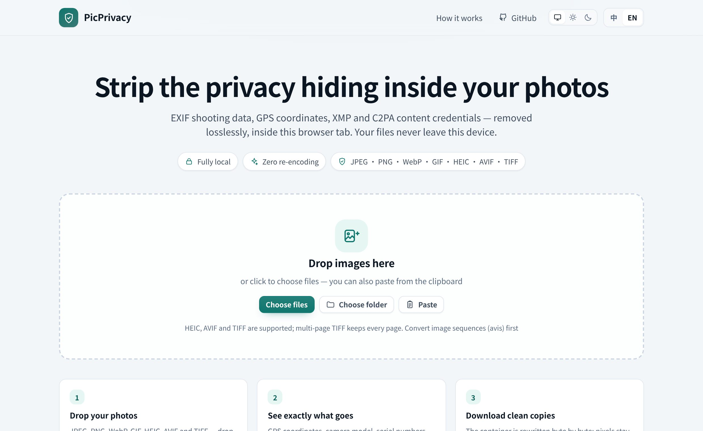
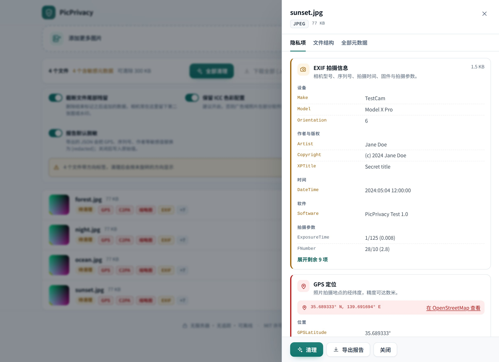
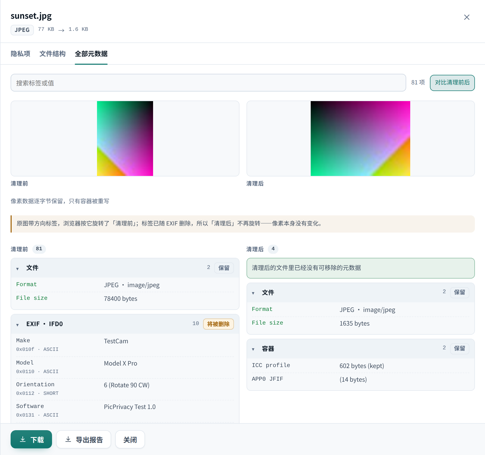

# PicPrivacy

**Strip the metadata hiding inside your photos — in your browser, without uploading anything.**

[Live demo](https://www.illageraris.dpdns.org/pic-privacy-rm/) · [中文说明](README.zh-CN.md)

Every photo you take carries more than pixels: the exact GPS coordinates, the camera and lens, a serial
number, the owner's email, sometimes a thumbnail of the uncropped original. Cameras and phones have done
this for years; newer tools add **C2PA content credentials**, signed provenance records that name the
software, the signer and every edit.

PicPrivacy shows you what is inside a file and then removes it — losslessly, byte by byte, locally.

## What it removes

| Container | Removed | Kept |
| --- | --- | --- |
| **JPEG** | EXIF (`APP1`), XMP and extended XMP, IPTC/Photoshop (`APP13`), JUMBF/C2PA (`APP11`), comments, JFXX thumbnails, MPF multi-pictures, unknown `APPn` segments, data appended after the end marker | pixel data, `APP0` JFIF, `APP2` ICC, `APP14` Adobe colour transform |
| **PNG** | `tEXt` / `zTXt` / `iTXt` text, `eXIf`, `tIME`, `caBX` (C2PA), Apple `iDOT`, unknown ancillary chunks | pixels, colour chunks (`iCCP`, `gAMA`, `sRGB`, …), APNG frames |
| **WebP** | `EXIF`, `XMP `, `C2PA`, `JUMBF` chunks (and the corresponding flag bits in `VP8X`) | pixels, alpha, animation, ICC |
| **GIF** | comment extensions, XMP application extension, trailing bytes | every frame, colour tables, looping |
| **HEIC / AVIF** | the `Exif` item (including GPS), the XMP `mime` item, `jumb` (C2PA), unknown items | picture items (tiles, `grid`, `av01`, alpha, thumbnails), codec and colour properties |
| **TIFF** | descriptive tags (Make / Model / Artist / Copyright / Software / DateTime / description / XP*), the Exif and GPS sub-directories, XMP (`0x02bc`), IPTC (`0x83bb`), Photoshop resources (`0x8649`), GeoTIFF georeferencing, reduced-resolution directories (thumbnails), APPn inside embedded JPEG strips, unknown tags | every page's pixel data (strips and tiles copied verbatim), size / depth / compression / colour tags, `Orientation`, ICC, `JPEGTables` |

Each file is re-scanned after cleaning and the download is blocked unless the result is provably clean.

## What it keeps, and why

Metadata is not only a privacy problem — some of it is needed for the picture to look right:

- **ICC colour profiles** keep wide-gamut photos from shifting colour. On by default; you can turn it off.
- **JFIF and the Adobe `APP14` flag** tell decoders how to interpret CMYK and YCCK JPEGs.
- **APNG and WebP animation structures** are what makes animated images animate.
- **Orientation** is the one tag with no perfect answer: dropping it can leave photos sideways in some
  viewers. The app warns you before cleaning a file that carries one; *Bake orientation into pixels*
  rotates the image with Canvas instead — that re-encodes the picture, so it costs a little quality and
  is strictly opt-in. HEIC is the exception: its orientation lives in the container's `irot` property,
  which travels with the picture items, so nothing goes sideways and nothing needs baking.

## Privacy by construction

- **No upload, no server, no analytics.** The production build ships a Content-Security-Policy with
  `connect-src 'none'`, and the build fails if any external resource sneaks in.
- **You can check it.** Open DevTools → Network, clean a hundred photos and watch: no requests. The app
  also works with the network disconnected.
- **Nothing is remembered.** Files live in tab memory; closing the tab drops them.

## Features

- Single files, whole folders by drag & drop, or paste from the clipboard.
- A per-file report: GPS coordinates (with an OpenStreetMap link), camera make and serial number,
  timestamps, every XMP property, IPTC fields, and the full C2PA manifest — signer, claim generator,
  action history, and the thumbnails those records may embed.
- **EXIF and XMP thumbnails are displayed**, because they often reveal the uncropped original.
- **Every metadata entry, listed.** A searchable table of everything a file carries: each IFD tag (IFD0,
  Exif, GPS, Interop, thumbnail directory), every XMP property, IPTC fields, C2PA claims, and the container
  blocks themselves. Vendor blobs such as MakerNote are not guessed at — they are shown as raw bytes in a
  hex viewer.
- **Before and after, side by side.** Once a file is cleaned, the picture and the full metadata table can
  be shown next to the original, so what survived is evidence rather than a promise.
- **Export a diagnostic report.** If a result ever looks wrong, download a JSON report of exactly what the
  engine saw — hashes, findings, container blocks, settings and the verification result — and attach it to
  a bug report. One file from its details panel, or the whole batch as a single document. Sensitive values
  (GPS coordinates, serial numbers, author fields) are replaced with `[redacted]` by default; turn
  *Redact exported reports* off to write the exact values. It describes the metadata, not the picture, so
  give it a read before sharing either way.
- **A spreadsheet summary.** Export the batch as CSV — file, format, size, findings, categories, bytes
  removed, output size and whether it verified — for a report to someone who does not read JSON.
- Batch clean, per-file states, progress — cancellable at any point, with the file in flight
  allowed to finish so its output is still verified — and a store-only ZIP for download that keeps the
  folders you dropped in.
- Optional deep-clean of trailing data after the end marker.
- English and Chinese UI, a light / dark / match-the-system switch, and a details dialog that keeps the
  keyboard inside it while open and hands focus back on close.

## Limits worth knowing

- **SVG and PDF are not supported yet.** They are reported as unsupported instead of
  being silently "cleaned".
- **TIFF handles multiple pages and embedded JPEG**: every page is rebuilt and re-linked into a new
  directory chain, a directory flagged as reduced resolution is dropped as a thumbnail, and compression-7
  strips are cleaned as standalone JPEG streams.
- **TIFF variants that are still refused**: BigTIFF, files with SubIFDs, camera raws (DNG / CR2 / CFA)
  and old-style JPEG (compression 6, whose stream hides behind `0x0201`). Those need a different rebuild
  or are not photographs at all, so they fail loudly instead of being half-cleaned.
- **HDR gain maps are removed.** Some phones store a second, auxiliary image (a `tmap` item) that carries
  the extra highlight information HDR displays use. It is not on the keep list, so it leaves with the other
  unrecognised items: the main image keeps its pixels and colour profile, but HDR viewers fall back to the
  dynamic range of the base image itself.
- **Browsers cannot preview HEIC or TIFF** (AVIF is fine and shows up normally). Chrome and friends cannot
  decode either one, so the thumbnail falls back to a file icon. Cleaning, verification and download all
  work normally, pixel for pixel.
- **Metadata is not content.** Faces, house numbers, reflections, watermarks and landmarks in the picture
  stay in the picture. If you need to anonymise the image itself, use a different tool.
- **Removing C2PA is deliberate.** Content credentials prove provenance; stripping them means the image
  can no longer be verified. That is exactly what a privacy clean-up wants, but keep the original if you
  work in a workflow that requires provenance.
- **JPEG quality is untouched** unless you enable orientation baking — the app never re-encodes by default.

## FAQ

**Is it really lossless?**
Yes. The container is rewritten; the entropy-coded image data is copied byte for byte and never decoded
or re-compressed. The test suite compares decoded pixels of every input and output.

**Why does my photo look rotated after cleaning?**
The EXIF orientation tag was part of the removed metadata. Such files are flagged before you clean them —
one click on *Bake orientation into pixels* rotates the pixels and fixes it for good. Otherwise let your
viewer rotate the image.

**Does it remove the "AI generated" label?**
It removes C2PA manifests and XMP fields, which is where such labels usually live. It cannot remove
visible watermarks or invisible pixel watermarks.

**Can I use it offline?**
Yes. Serve the built files from anywhere, or open the deployed page once and pick *Install* in the
browser menu — after that it starts without a network like any other app.

## Contributing

Development setup, architecture notes and the test strategy live in [CONTRIBUTING.md](CONTRIBUTING.md).

## License

[MIT](LICENSE)
