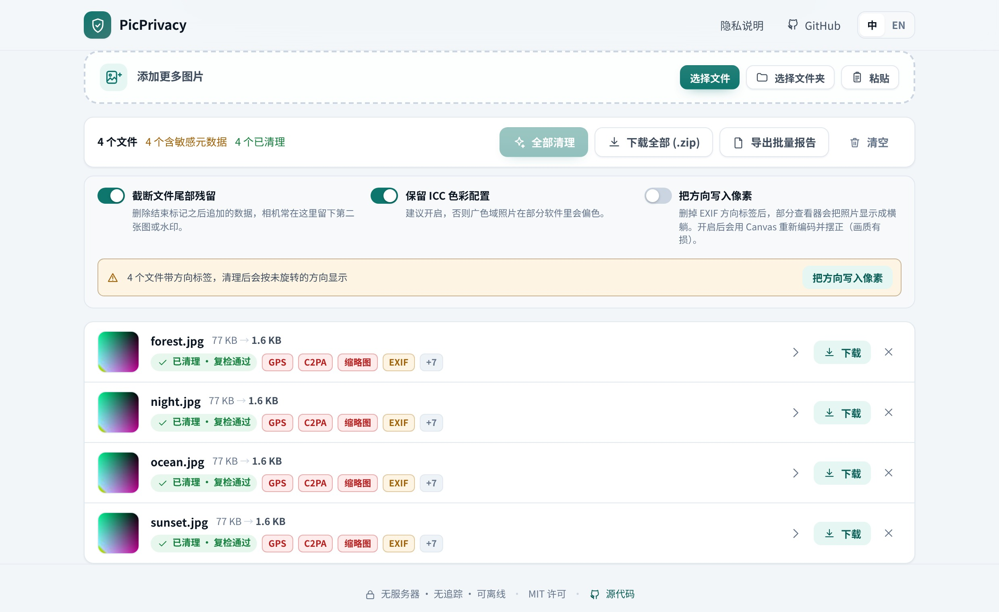
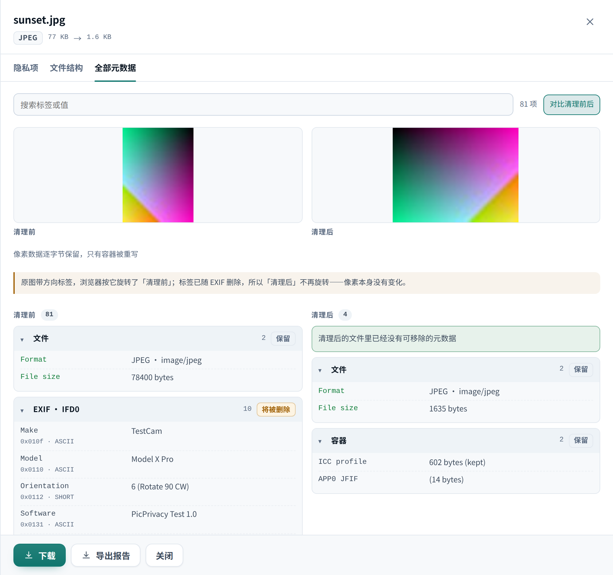

# PicPrivacy

**在浏览器里直接洗掉照片里的隐藏信息，文件不会离开这台设备。**

[在线使用](https://illagercpr.github.io/pic-privacy-rm/) · [English](README.md)

每张照片带走的东西远不止像素：精确的 GPS 坐标、相机与镜头型号、机身序列号、机主邮箱，有时还有
一张"裁剪前原图"的缩略图。相机的 EXIF 已经存在二十多年，而新工具又加上了 **C2PA 内容凭证**——
一份带密码学签名的来源记录，写明软件、签名者和每一次编辑。

PicPrivacy 把文件里到底有什么摆给你看，然后逐字节地删掉——无损、本地、不联网。

## 会删除什么

| 容器 | 删除 | 保留 |
| --- | --- | --- |
| **JPEG** | EXIF（`APP1`）、XMP 与扩展 XMP、IPTC/Photoshop（`APP13`）、JUMBF/C2PA（`APP11`）、注释、JFXX 缩略图、MPF 多图、未知 `APPn` 段、结束标记之后追加的数据 | 像素码流、`APP0` JFIF、`APP2` ICC、`APP14` Adobe 色彩变换 |
| **PNG** | `tEXt`/`zTXt`/`iTXt` 文本、`eXIf`、`tIME`、`caBX`（C2PA）、Apple `iDOT`、未知辅助块 | 像素、色彩块（`iCCP`、`gAMA`、`sRGB`…）、APNG 动画帧 |
| **WebP** | `EXIF`、`XMP `、`C2PA`、`JUMBF` 块（并清除 `VP8X` 中对应的标志位） | 像素、透明通道、动画、ICC |
| **GIF** | 注释扩展、XMP 应用扩展、尾部残留 | 每一帧、调色板、循环设置 |
| **HEIC / AVIF** | `Exif` 项目（含 GPS）、XMP `mime` 项目、`jumb`（C2PA）、未知项目 | 图像项目（瓦片、`grid`、`av01`、alpha、缩略图、HDR gain map）、解码与色彩属性 |
| **TIFF** | 描述性标签（Make / Model / Artist / Copyright / Software / DateTime / 描述 / XP*）、Exif 与 GPS 子目录、XMP（`0x02bc`）、IPTC（`0x83bb`）、Photoshop 资源（`0x8649`）、GeoTIFF 地理参考、缩小版目录（缩略图）、内嵌 JPEG 条带里的 APPn、未知标签 | 每一页的像素数据（条带与瓦片原样搬运）、尺寸 / 位深 / 压缩 / 色彩相关标签、`Orientation`、ICC、`JPEGTables` |

每个文件处理完都会重新扫描一遍：只要还有任何残留，就不允许下载。

## 为什么保留这些东西

元数据不全都是隐私问题，有些删掉照片就"坏"了：

- **ICC 色彩配置**决定广色域照片的颜色。默认保留，可在设置里关闭。
- **JFIF 与 Adobe `APP14`** 决定 CMYK/YCCK 的 JPEG 如何解释颜色。
- **APNG、WebP 动画结构**是动图能动的原因。
- **方向（Orientation）** 是最两难的一个标签：删掉后部分查看器会把照片显示成横躺。带这个标签的文件
  在清理前会先给出提示，可以一键打开「把方向写入像素」，用 Canvas 真正旋转画面——代价是重新编码、
  画质略有损失，因此默认关闭。HEIC 例外：它的方向记在容器的 `irot` 属性里，图像项目一起保留，
  清理后不会横躺，也就不需要烘焙。

## 隐私是设计出来的

- **不上传、无服务器、无统计。** 生产版本自带 `connect-src 'none'` 的 CSP，一旦构建产物里混入外部资源，
  CI 会直接失败。
- **可以自己验证。** 打开开发者工具的 Network 面板，处理一百张照片也不会有任何请求；断网后页面照样能用。
- **不记任何东西。** 文件只在标签页内存里；关掉标签页即消失。

## 功能

- 单张、整个文件夹拖入，或直接从剪贴板粘贴。
- 逐文件报告：GPS 坐标（附 OpenStreetMap 链接）、相机型号与序列号、时间戳、全部 XMP 属性、IPTC 字段，
  以及完整的 C2PA 清单——签名者、声明生成器、操作历史，乃至凭证里嵌的缩略图。
- **EXIF / XMP 内嵌缩略图会直接显示出来**，它们常常暴露裁剪前的完整画面。
- **全部元数据逐条列出。** 可搜索的表格，把文件里带的东西全摊开：每个 IFD 标签（IFD0、拍摄参数、GPS、
  兼容性、缩略图目录）、全部 XMP 属性、IPTC 字段、C2PA 声明，以及容器块本身。MakerNote 这类厂商私有数据
  不去猜，用十六进制查看器原样显示字节。
- **清理前后并排对比。** 清理完成后可以对输出文件再跑一遍同一张表，与原件左右对照——剩下的东西是证据，
  而不是一句承诺。
- **导出诊断报告。** 如果觉得结果不对，可以下载一份 JSON，里面是引擎实际看到的东西：文件哈希、全部
  检测项、容器块、生效设置与复检结果，附在 issue 里就能复现。它描述的是元数据而不是画面，分享前仍请过目。
- 批量清理、逐文件状态、进度条，以及 store 模式打包的 ZIP 下载。
- 可选的「深度清理」：截断结束标记之后的残留数据。
- 中英双语界面、明暗主题、键盘可操作。

## 需要知道的限制

- **暂不支持 SVG、PDF**。这些格式会明确提示"不支持"，而不是假装清理过。
- **TIFF 的多页与内嵌 JPEG 都已支持**：每一页会各自重建并重新串成目录链，标为缩小版（NewSubfileType）
  的目录当作缩略图整份删除，压缩方式 7 的条带会当成独立 JPEG 再清一遍。
- **仍然拒绝的 TIFF 变体**：BigTIFF、带 SubIFD 的文件、相机原始格式（DNG / CR2 / CFA）、老式 JPEG
  （压缩方式 6，码流藏在 `0x0201` 里）。这些要么需要另一种重建方式，要么本身就不是"照片"，
  所以明确报错而不是半清理。
- **浏览器无法预览 HEIC 和 TIFF**（AVIF 没有这个问题，Chrome 能正常显示）。Chrome 等浏览器根本解不开
  这两种格式，所以文件行的缩略图会变成图标。清理、复检和下载都正常，像素一位不差。
- **元数据不是画面内容。** 拍到的人脸、门牌、倒影、水印、地标仍然留在画面里。要匿名化画面本身，请另找工具。
- **删除 C2PA 是刻意的。** 内容凭证用于证明来源；删掉之后这张图不再可验证。这正是隐私清理的目的，
  但如果你处在需要溯源的工作流里（新闻、广告合规），请保留原图。
- **默认不重新编码**，JPEG 画质不受影响——除非你主动打开方向烘焙。

## 常见问题

**真的是无损吗？**
是。只重写容器结构，熵编码的像素数据逐字节复制，从不解码、从不重新压缩。测试套件会对比每个输入与
输出解码后的像素。

**清理后照片为什么是横的？**
EXIF 方向标签被删掉了。这类文件在清理前会有提示，点一下「把方向写入像素」重新处理即可彻底解决；
或者让查看器自己旋转。

**能删掉"AI 生成"标记吗？**
会删掉 C2PA 清单与 XMP 字段——这类标记通常就住在那里。但画面里可见的水印、以及隐写在像素里的水印，
它删不掉。

**能离线用吗？**
可以。构建产物放在任何静态服务器上都能跑；在线页面打开过一次后断网也能继续用。

## 参与开发

开发环境、架构说明与测试策略见 [CONTRIBUTING.md](CONTRIBUTING.md)。

## 许可

[MIT](LICENSE)
